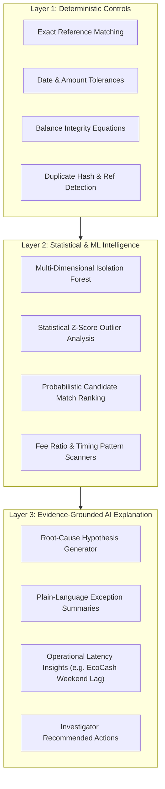

# ReconOS AI — Three-Layer Financial Intelligence Architecture

## 1. Principles of AI Financial Operations

1. **Deterministic Floor:** Financial arithmetic, ledger sums, and deterministic match rules are never delegated to statistical or generative models.
2. **Evidence-Grounded Explanations:** Every hypothesis or anomaly explanation produced by the intelligence layer must link directly to underlying ledger IDs, dates, and amounts.
3. **Strict Advisory Guarantee:** The AI layer operates in a strictly read-only advisory capacity. It cannot independently authorize transactions, mutate account balances, or write off exceptions.

---

## 2. The Three Layers

### Layer 1: Deterministic Controls
Provides mathematical certainty. Validates file integrity, checks cryptographic hashes, enforces uniqueness on external references, and computes exact mathematical variances.

### Layer 2: Statistical & Machine Learning Intelligence
- **Isolation Forest (`scikit-learn`):**
  Identifies structural irregularities across a 4-dimensional feature vector:
  $$\vec{x} = \begin{bmatrix} \ln(\text{Amount} + 1) \\ \text{Hour of Day} \in [0, 23] \\ \text{Day of Week} \in [0, 6] \\ \frac{\text{Fee}}{\text{Amount}} \end{bmatrix}$$
- **Normalized Anomaly Score:**
  Maps raw isolation path lengths to an intuitive interval $[0.0, 1.0]$. Transactions with score $\ge 0.70$ or satisfying multiple statistical thresholds are flagged for human review.
- **Probabilistic Candidate Match Ranking:**
  When multiple potential counterpart transactions exist, the `CandidateRanker` evaluates:
  $$\text{Score} = 0.40 \cdot S_{\text{ref}} + 0.30 \cdot S_{\text{amount}} + 0.20 \cdot S_{\text{temporal}} + 0.10 \cdot S_{\text{narrative}}$$
  Where $S_{\text{ref}}$ is character-level sequence similarity, $S_{\text{amount}}$ is relative proximity, and $S_{\text{temporal}}$ decays linearly over 7 days.

### Layer 3: Evidence-Grounded AI Explanation
- Synthesizes findings into natural-language briefings for human finance managers.
- Cites exact timestamps, currency amounts, and counterpart references.
- Identifies macro patterns, such as banking clearinghouse weekend cut-offs and mobile-money provider settlement lags.
