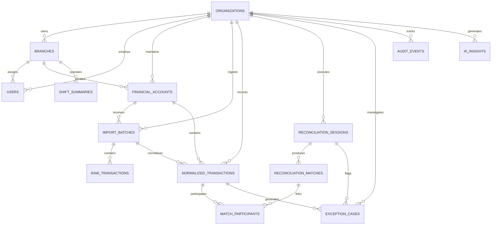

# ReconOS AI — Database Entity-Relationship Diagram & Schema Specification

## 1. Schema Diagram (Mermaid)

---

## 2. Table Specifications

### `organizations`
- `id` (VARCHAR(36), PK): UUID
- `name` (VARCHAR(255), UNIQUE): Enterprise legal name
- `slug` (VARCHAR(100), UNIQUE): URL-safe organization slug
- `default_currency` (VARCHAR(3)): ISO 4217 currency code (e.g., USD, ZWG, KES)
- `is_active` (BOOLEAN): Status flag
- `created_at` (DATETIME): UTC creation timestamp
- `updated_at` (DATETIME): UTC update timestamp

### `branches`
- `id` (VARCHAR(36), PK): UUID
- `organization_id` (VARCHAR(36), FK $\rightarrow$ `organizations.id` ON DELETE CASCADE)
- `name` (VARCHAR(255)): Branch location name (e.g., "CBD Flagship Store")
- `code` (VARCHAR(50)): Internal branch accounting code (e.g., "HRE-CBD-01")
- `address`, `city`, `country` (VARCHAR)
- `is_active` (BOOLEAN)
- `created_at` (DATETIME)

### `users`
- `id` (VARCHAR(36), PK): UUID
- `organization_id` (VARCHAR(36), FK $\rightarrow$ `organizations.id` ON DELETE CASCADE)
- `branch_id` (VARCHAR(36), FK $\rightarrow$ `branches.id` ON DELETE SET NULL, NULL for org-wide)
- `email` (VARCHAR(255), INDEX): Login email
- `hashed_password` (VARCHAR(255)): Bcrypt salted hash
- `full_name` (VARCHAR(255))
- `role` (ENUM: `owner`, `finance_manager`, `accountant`, `branch_manager`, `operator`, `auditor`, `admin`)
- `is_active` (BOOLEAN)
- `created_at` (DATETIME)

### `financial_accounts`
- `id` (VARCHAR(36), PK): UUID
- `organization_id` (VARCHAR(36), FK $\rightarrow$ `organizations.id`)
- `branch_id` (VARCHAR(36), FK $\rightarrow$ `branches.id`)
- `name` (VARCHAR(255)): Account descriptor (e.g., "Stanbic Operating Account")
- `account_type` (ENUM: `BANK`, `MOBILE_MONEY`, `POS_TERMINAL`, `CASH_DRAWER`, `GATEWAY`, `ERP_LEDGER`)
- `provider_name` (VARCHAR(100)): Provider entity (e.g., "Stanbic Bank", "EcoCash")
- `account_number` (VARCHAR(100)): Bank account or merchant code
- `currency` (VARCHAR(3))
- `opening_balance` (NUMERIC(18, 4))
- `current_balance` (NUMERIC(18, 4))
- `is_active` (BOOLEAN)

### `import_batches`
- `id` (VARCHAR(36), PK): UUID
- `organization_id` (VARCHAR(36), FK $\rightarrow$ `organizations.id`)
- `financial_account_id` (VARCHAR(36), FK $\rightarrow$ `financial_accounts.id`)
- `file_name` (VARCHAR(255))
- `file_hash` (VARCHAR(64), INDEX): SHA-256 cryptographic digest for duplicate prevention
- `file_type` (ENUM: `CSV`, `XLSX`, `MANUAL`)
- `status` (ENUM: `PENDING`, `PARSING`, `NORMALIZED`, `FAILED`)
- `total_rows`, `valid_rows`, `error_rows` (INTEGER)
- `column_mapping` (JSON): Persisted field mapping
- `created_by_id` (VARCHAR(36), FK $\rightarrow$ `users.id`)
- `created_at` (DATETIME)

### `raw_transactions`
- `id` (VARCHAR(36), PK): UUID
- `organization_id` (VARCHAR(36), FK)
- `batch_id` (VARCHAR(36), FK $\rightarrow$ `import_batches.id`)
- `row_number` (INTEGER)
- `raw_data` (JSON): Exact original statement line content for lineage preservation
- `error_message` (VARCHAR(500), NULL)
- `created_at` (DATETIME)

### `normalized_transactions`
- `id` (VARCHAR(36), PK): UUID
- `organization_id` (VARCHAR(36), FK)
- `batch_id` (VARCHAR(36), FK)
- `financial_account_id` (VARCHAR(36), FK)
- `branch_id` (VARCHAR(36), FK)
- `external_reference` (VARCHAR(100), INDEX): Provider transaction reference
- `internal_reference` (VARCHAR(100), INDEX): System-assigned canonical reference
- `transaction_date` (DATETIME, INDEX)
- `amount` (NUMERIC(18, 4)): Absolute transaction value
- `currency` (VARCHAR(3))
- `transaction_type` (ENUM: `DEBIT`, `CREDIT`)
- `fee_amount` (NUMERIC(18, 4), DEFAULT 0)
- `balance_after` (NUMERIC(18, 4), NULL)
- `counterparty_name`, `counterparty_account`, `description` (VARCHAR)
- `reconciliation_status` (ENUM: `UNRECONCILED`, `MATCHED`, `PARTIALLY_MATCHED`, `EXCEPTION`, `MANUAL_REVIEW`)
- `is_duplicate` (BOOLEAN, INDEX)
- `duplicate_of_id` (VARCHAR(36), FK $\rightarrow$ `normalized_transactions.id`)
- `anomaly_score` (FLOAT): Machine-learning anomaly score (0.00 to 1.00)
- `anomaly_flag` (BOOLEAN)
- `anomaly_reasons` (JSON)
- `created_at` (DATETIME)

### `reconciliation_sessions`
- `id` (VARCHAR(36), PK): UUID
- `organization_id` (VARCHAR(36), FK)
- `session_name` (VARCHAR(255))
- `primary_account_id` (VARCHAR(36), FK)
- `secondary_account_id` (VARCHAR(36), FK)
- `date_from`, `date_to` (DATETIME)
- `status` (ENUM: `DRAFT`, `IN_PROGRESS`, `COMPLETED`, `APPROVED`)
- `total_primary_count`, `total_secondary_count` (INTEGER)
- `total_primary_amount`, `total_secondary_amount` (NUMERIC(18, 4))
- `matched_count` (INTEGER)
- `matched_amount` (NUMERIC(18, 4))
- `discrepancy_amount` (NUMERIC(18, 4))
- `rule_config` (JSON): Tolerances and matching criteria
- `initiated_by_id`, `approved_by_id` (VARCHAR(36), FK)
- `approved_at` (DATETIME)

### `reconciliation_matches`
- `id` (VARCHAR(36), PK): UUID
- `session_id` (VARCHAR(36), FK $\rightarrow$ `reconciliation_sessions.id`)
- `match_type` (ENUM: `EXACT_REFERENCE`, `AMOUNT_DATE_TOLERANCE`, `ONE_TO_MANY`, `MANY_TO_ONE`, `MANUAL_OVERRIDE`)
- `confidence_score` (NUMERIC(5, 2)): E.g., 100.00%
- `status` (ENUM: `SUGGESTED`, `CONFIRMED`, `REJECTED`)
- `primary_amount_total`, `secondary_amount_total`, `difference_amount` (NUMERIC(18, 4))
- `notes` (VARCHAR(500))
- `matched_by_user_id` (VARCHAR(36), FK)

### `match_participants`
- `id` (VARCHAR(36), PK): UUID
- `match_id` (VARCHAR(36), FK $\rightarrow$ `reconciliation_matches.id`)
- `transaction_id` (VARCHAR(36), FK $\rightarrow$ `normalized_transactions.id`)
- `side` (ENUM: `PRIMARY`, `SECONDARY`)
- `allocated_amount` (NUMERIC(18, 4))

### `exception_cases`
- `id` (VARCHAR(36), PK): UUID
- `organization_id` (VARCHAR(36), FK)
- `session_id` (VARCHAR(36), FK, NULL)
- `transaction_id` (VARCHAR(36), FK, NULL)
- `case_number` (VARCHAR(50), UNIQUE)
- `title`, `description` (VARCHAR)
- `category` (ENUM: `MISSING_TRANSACTION`, `AMOUNT_MISMATCH`, `DUPLICATE_ENTRY`, `UNRECOGNIZED_FEE`, `TIMING_DELAY`, `CASH_SHORTAGE`)
- `severity` (ENUM: `LOW`, `MEDIUM`, `HIGH`, `CRITICAL`)
- `status` (ENUM: `OPEN`, `UNDER_INVESTIGATION`, `RESOLVED`, `CLOSED`, `ESCALATED`)
- `discrepancy_amount` (NUMERIC(18, 4))
- `currency` (VARCHAR(3))
- `assigned_to_id`, `created_by_id` (VARCHAR(36), FK)
- `ai_analysis` (JSON)
- `evidence` (JSON)
- `resolution_notes` (VARCHAR(1000))
- `resolved_at` (DATETIME)

### `shift_summaries`
- `id` (VARCHAR(36), PK): UUID
- `organization_id` (VARCHAR(36), FK)
- `branch_id` (VARCHAR(36), FK)
- `cashier_id` (VARCHAR(36), FK)
- `cashier_name` (VARCHAR(255))
- `shift_date` (DATE)
- `shift_number` (VARCHAR(50))
- `opening_cash`, `cash_sales`, `mobile_money_sales`, `card_sales`, `cash_payouts` (NUMERIC(18, 4))
- `closing_cash_counted`, `system_expected_cash`, `cash_discrepancy` (NUMERIC(18, 4))
- `status` (ENUM: `SUBMITTED`, `VERIFIED`, `DISCREPANCY_FLAGGED`)
- `supervisor_notes` (VARCHAR(500))
- `verified_by_id` (VARCHAR(36), FK)

### `audit_events`
- `id` (VARCHAR(36), PK): UUID
- `organization_id` (VARCHAR(36), FK)
- `user_id` (VARCHAR(36), FK, NULL)
- `action` (VARCHAR(100)): Action identifier (e.g. "RUN_RECONCILIATION_ENGINE")
- `resource_type` (VARCHAR(100))
- `resource_id` (VARCHAR(36))
- `details` (JSON): Context parameters
- `ip_address` (VARCHAR(45))
- `created_at` (DATETIME): Immutable timestamp
