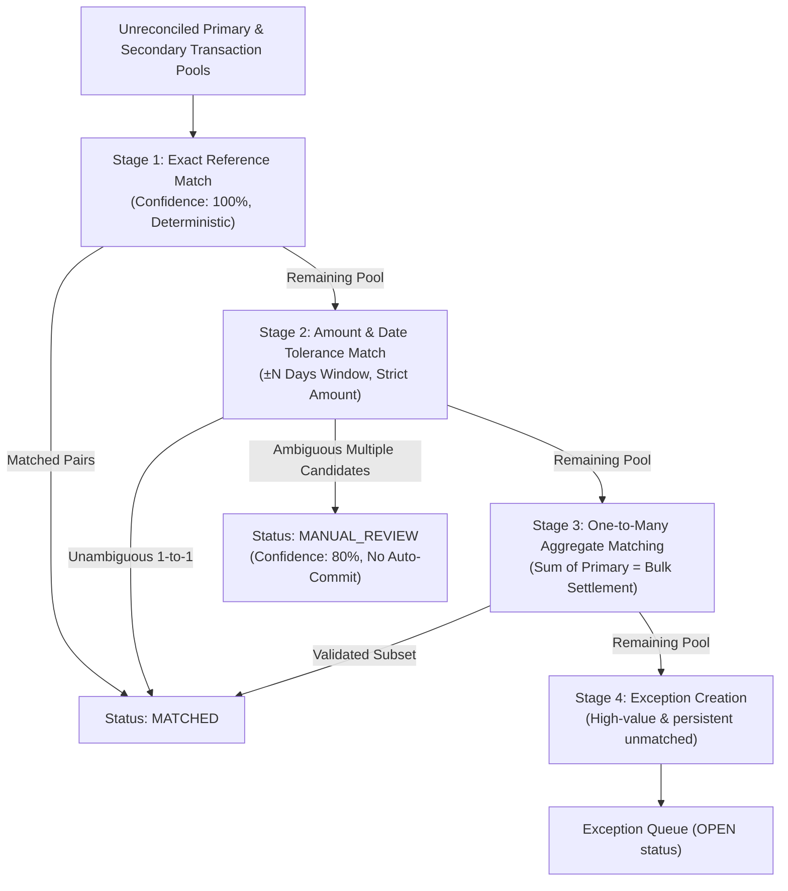

# ReconOS AI — Financial Reconciliation Engine Specification

## 1. Mathematical Guarantees & Precision Standards

Financial calculations in ReconOS AI adhere to the following non-negotiable standards:

1. **Arbitrary-Precision Decimal Representation:**
   All monetary amounts, fees, and balance verifications use Python's standard `Decimal` type quantized to 4 decimal places (`0.0001`). Floating-point approximations (`float`) are prohibited in the ledger and matching pipelines.

2. **Balance Conservation Equation:**
   For any financial account over an arbitrary reconciliation interval $[t_0, t_1]$:
   $$\text{Closing Balance}_{\text{expected}} = \text{Opening Balance} + \sum \text{Credits} - \sum \text{Debits}$$
   $$\text{Variance} = \text{Actual Closing Balance} - \text{Closing Balance}_{\text{expected}}$$
   Reconciliation status is valid if and only if $\text{Variance} = 0.0000$.

---

## 2. Multi-Stage Deterministic Reconciliation Pipeline

### Stage 1: Exact Reference Matching
- **Algorithm:** Two-pointer or hash map index on cleaned, normalized external reference strings (`external_reference.strip().upper()`).
- **Condition:** $\text{Ref}_P = \text{Ref}_S$ and $\text{Amount}_P = \text{Amount}_S$.
- **Confidence:** `100.00%`.
- **Action:** Automatically marked `CONFIRMED` and transactions set to `MATCHED`.

### Stage 2: Amount and Date Tolerance Matching
- **Algorithm:** Temporal window scan where $|\text{Date}_P - \text{Date}_S| \le \Delta_{\text{days}}$ (default $\Delta_{\text{days}} = 2$).
- **Condition:** $|\text{Amount}_P - \text{Amount}_S| \le \epsilon$.
- **Handling Ambiguity:** If transaction $P_1$ could match $S_1$ and $S_2$, neither is silently approved. The candidate pair is marked as `SUGGESTED` (`confidence = 80.00%`), and the transaction status is updated to `MANUAL_REVIEW`.

### Stage 3: One-to-Many & Many-to-One Aggregate Matching
- **Use Case:** High-volume POS card settlements or mobile-money merchant payouts where one bulk bank deposit of e.g. $\$1,250.00$ settles multiple individual customer sales.
- **Algorithm:** Subset sum combination evaluator within a narrow temporal window ($\Delta_{\text{days}} = 3$, group size $k \le 5$).
- **Condition:** $\sum_{i=1}^k \text{Amount}_{P_i} = \text{Amount}_S$.

### Stage 4: Manual Override & Approval Workflow
- Authorized accountants and finance managers can manually link arbitrary transactions in the Reconciliation Workspace.
- All manual overrides log participant IDs, allocated amounts, decision notes, and the author's user ID in `audit_events`.
- A completed reconciliation session requires formal two-eye approval from a `Finance Manager` or `Owner`.
